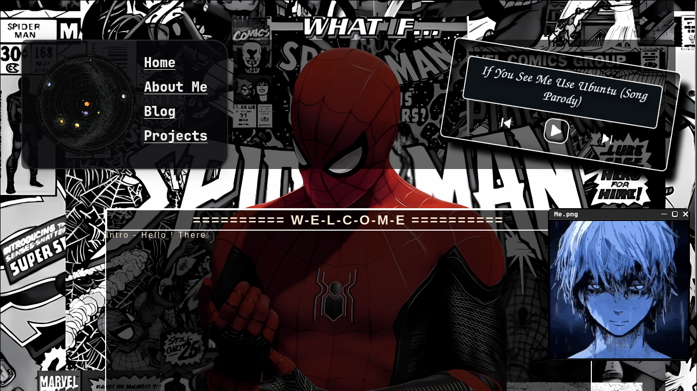
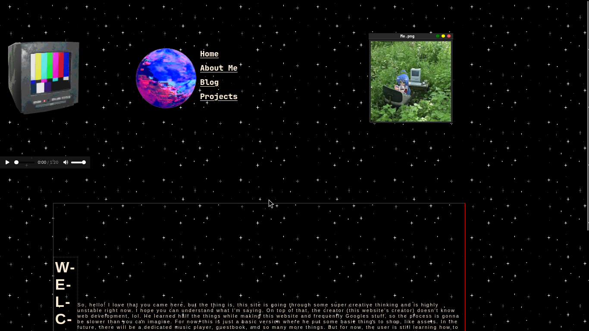
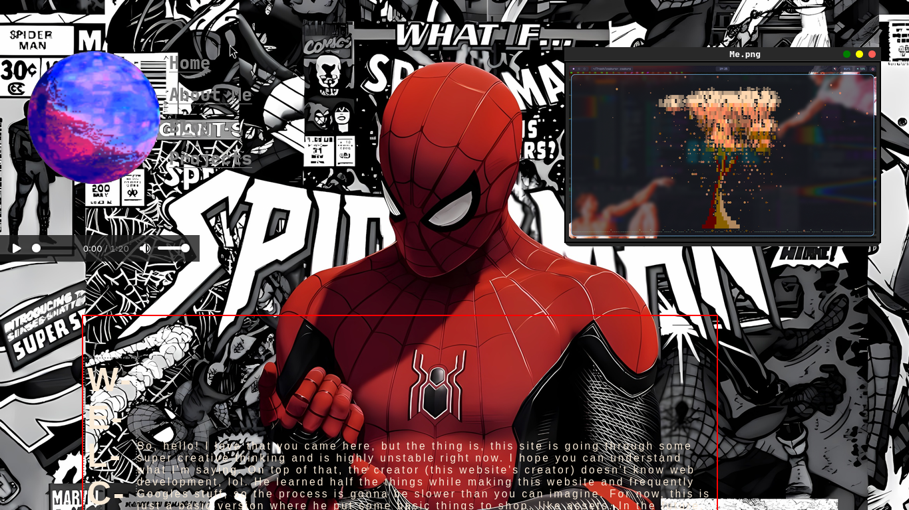
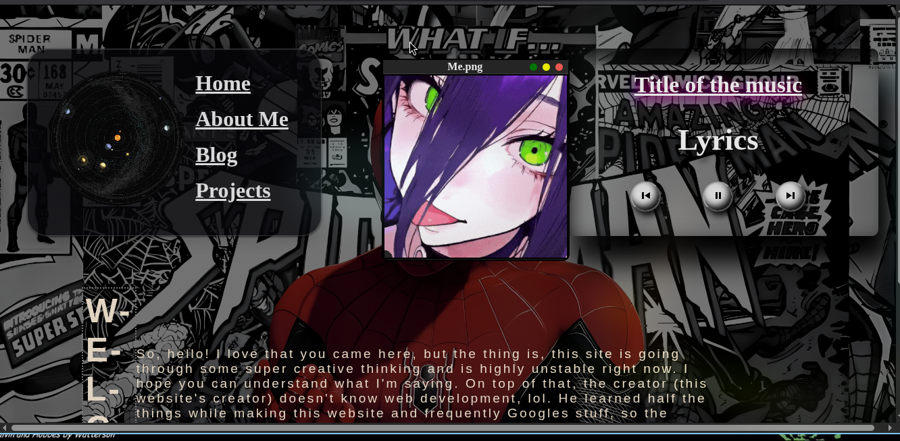
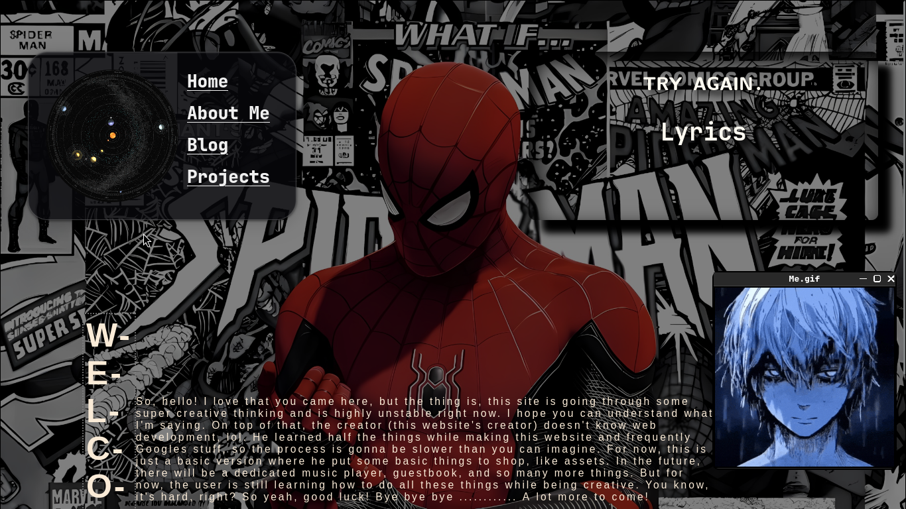

# Cool Indie Portfolio Website

Just an image of the homepage : )



## About

This is the code for my indie website, which I started working on after discovering some really cool websites on Neocities. I always wanted to make something like those, so here I am!

The website is still incomplete, and I'm constantly working on it. There's a lot more to come!

## How to Run Locally

This project now uses **npm** because it's getting bigger : )

Here's how you can run it locally:

1. Clone or download the repository.

2. Install the dependencies:

   ```bash
   npm install
   ```

   This will install Vite and the other project dependencies.

3. Start the development server:

   ```bash
   npm run dev
   ```

   This will start the Vite development server and give you a local link. Open that link in your browser, and you're good to go!

I'd also recommend learning a little about npm. It'll help you with many other things too.

## Fair Use

You can use the code however you want, just don't copy it without giving me credit. Go download the code and have fun with it! You can absolutely use it as inspiration to make something similar, of course.

It's hosted on GitHub Pages. Here's the link to the repository:

[GitHub Repository](https://github.com/Krish-Saga/web)

## Easter Eggs

Tbh, this website is going through a lot of changes, but the goal is to fill it with Easter eggs and cool indie stuff that reflects my personality : ) (which I don't have lol).

And yeah, it's still in its early days.

1. Try hovering over the globe.
2. You can move the image. There'll be something cool related to it in future updates.
3. Try hovering over everything!
4. Make sure to click every button. Some of them might not work yet because I'll add their functionality in future updates.

I've thought of a lot more Easter eggs that I'll add in future updates. I'll update this section as soon as I implement them.

## License

This project is licensed under the MIT License.

## Blah Blah

What are you reading? What else is there to say? Can't you just explore the website? Who tf reads a README this long, man? You're not human. Go away, AI.

And don't forget to check out my website! Now just gooooo 🏃‍♂️💨

## Extra Info

Fine, you wanna know more?

There'll be a guestbook and a dedicated blog section. Open blog, lol. Yeah, you'll be able to create an account and write a blog about anything : )

Just don't make it creepy or anything like that : )

And ofc, I don't want this to end up in some YouTube video about creepy websites, lol.

More things are coming, of course! I can't write all of them here.

Just gooooooooooooooooooooooooooooooooooooo.

## Work in Progress

Well, I'll update this section whenever I add something new!

## Previous Versions

Here's a look at how the website has changed over time. You can compare the previous designs with the current one.

### Base 1



### Base 2



### Base 3



### Base 4


