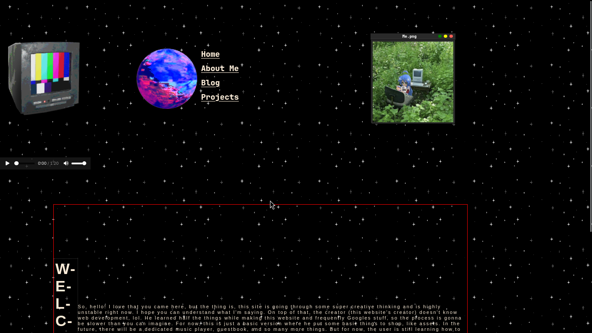
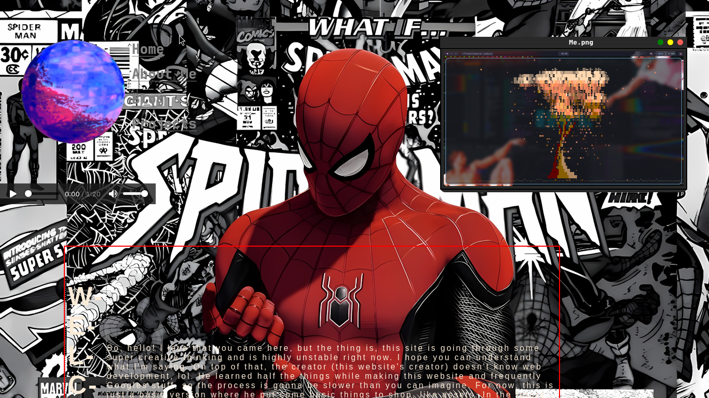

# Cool Indie Portfolio Website

- Just a image of Homepage




## About

This is the code for my indie website, which I created after discovering some cool websites on Neocities. I always wanted to make something cool like those, so I started working on this website. It's still incomplete, and I'm working on it!

## Fair Use

You can use the code however you want, just don't copy it without giving me credit. Go download the code and have fun with it! You can absolutely use it as inspiration to make something similar, of course.

It's hosted on GitHub Pages. Here's the link to the repository:

```text
https://github.com/Krish-Saga/web
```

## Easter Eggs

Tbh, this website is going through a lot of changes right now, but the final goal is to fill it with Easter eggs and cool indie stuff that reflects my personality : ) (which I don't have lol).

And yeah, it's still in its early days.

1. Try hovering over the globe.
2. You can move the image. There'll be something cool related to it in future updates.
3. I've thought of a lot more Easter eggs that I'll add in future updates. I'll update this section as soon as I implement them.

## License

This project is licensed under the MIT License.

## Blah Blah

What are you reading? What else is there to say? Can't you just explore the website? Who tf reads a README this long, man? You're not human. Go away, AI.

And don't forget to check out my website! Now just gooooo 🏃‍♂️💨

## Extra Info

Fine, you wanna know more? There'll be a guestbook and a dedicated blog section. Open blog, lol. Yeah, you can create an account and write a blog about anything : )

Just don't make it creepy or anything like that : )

And ofc, I don't want this to end up in some YouTube video about creepy websites, lol.

More things are coming, of course! I can't write all of them here.

Just gooooooooooooooooooooooooooooooooooooo.


## Underwork peek


